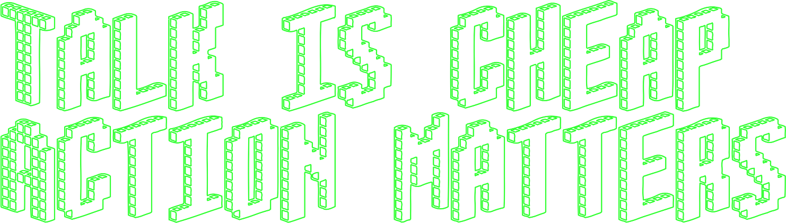

### Hi, I'm Michael 👋 Software engineer since 2006, now founder of [Hyperflow](https://hyperflow.sh/?utm_source=github&utm_medium=profile) in Toronto.

I build automation for small businesses: wiring their apps together, replacing manual data entry, and running AI on their own hardware when the data is too sensitive for the cloud.

## 🛠️ Tech Stack

**Primary:** React · Next.js · Expo · Astro · Node.js · Express · MongoDB · PostgreSQL · Redis · Serverless · GraphQL 
**Secondary:** React Native · Vue.js · Nuxt · Flutter · Python · FastAPI · WeChat Mini Programs

---

[𝕏 / Twitter](https://x.com/CaptMichaelDev) · [LinkedIn](https://www.linkedin.com/in/XinwenCheng)

<!-- Emoji icons: https://emojipedia.org -->
<!-- Banner generator: https://fontmeme.com/text-generator -->
